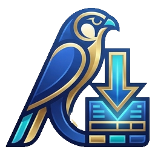

# Kemet Download

**Free, open-source, ad-free media downloader — fast, light, built with Rust + Tauri.**

[**⬇ Download for Windows**](https://github.com/Youseff-Abdelnaby/kemet-download/releases/latest) · [Report a bug](https://github.com/Youseff-Abdelnaby/kemet-download/issues) · [Contribute](CONTRIBUTING.md)

---

## English

### Features

- Paste one link or a whole list, or drop a `.txt` file full of links — everything goes into a tidy queue.
- Quality from 360p up to 4K / 8K (when the source offers it), or audio only (MP3, M4A, Opus, FLAC, best original).
- Choose **MP4 or MKV** and prefer **H.264, H.265 or AV1**. Audio and video are merged automatically.
- Several downloads at once, **pause / resume**, and automatic retry if your connection drops.
- Uses browser cookies for sites that need a login.
- Powered by [yt-dlp](https://github.com/yt-dlp/yt-dlp) (thousands of supported sites), [FFmpeg](https://ffmpeg.org) and [Deno](https://deno.com). One button updates the engine.
- No ads. No tracking. No account.

### Roadmap

- [x] Windows app
- [ ] Android app (same design, separate build — coming next)
- [ ] Folders & playlists organisation, hotkeys, auto-update

### Install

Download the latest `.exe` installer from the [Releases page](https://github.com/Youseff-Abdelnaby/kemet-download/releases/latest) and run it.
Windows may show a SmartScreen warning because the app is not code-signed: click **More info → Run anyway**.

### Responsible use

Kemet Download is a tool. Only download content you own, that is in the public domain, or that you have permission to save, and respect the terms of the sites you use and the laws of your country. DRM-protected content is not supported.

### Build it yourself

Pushing to this repo builds the installer automatically with GitHub Actions (see `.github/workflows/build.yml`). To build locally you need Rust, Node.js and the Tauri prerequisites, then run `npx tauri build`.

### Contributing

Anyone can fork, change and improve this project. See [CONTRIBUTING.md](CONTRIBUTING.md). Stars ⭐ and shares help a lot.

### License & credits

Kemet Download's own code is released under the [MIT License](LICENSE).
It bundles third-party tools that keep their own licenses: yt-dlp (Unlicense), FFmpeg (GPL build), Deno (MIT), Tauri (MIT / Apache-2.0).

---

## بالعربي

**كيميت داونلود** تطبيق تحميل **مجاني ومفتوح المصدر وبدون إعلانات**، خفيف وسريع، مبني بـ Rust وTauri.

### المميزات

- الصق رابط أو عدة روابط، أو اسحب ملف `.txt` فيه روابط، وكلها تدخل في قائمة منظمة.
- جودات من 360p لحد 4K و8K (لو المصدر بيوفرها)، أو صوت فقط (MP3 وM4A وOpus وFLAC).
- اختيار **MP4 أو MKV** وأفضلية كودك **H.264 أو H.265 أو AV1**، مع دمج الصوت والفيديو تلقائياً.
- تحميلات متزامنة، **إيقاف مؤقت واستئناف**، وإعادة محاولة تلقائية لو النت قطع.
- دعم كوكيز المتصفح للمواقع اللي محتاجة تسجيل دخول.
- المحرك: yt-dlp وFFmpeg وDeno، وزرار واحد لتحديثه.
- بدون إعلانات، بدون تتبع، بدون حساب.

### قريباً

- نسخة **أندرويد** بنفس التصميم (بناء منفصل).
- تنظيم الملفات في فولدرات وقوائم، اختصارات لوحة المفاتيح، تحديث تلقائي.

### التثبيت

نزّل ملف الـ `.exe` من [صفحة الإصدارات](https://github.com/Youseff-Abdelnaby/kemet-download/releases/latest) وشغّله. لو ظهر تحذير SmartScreen اضغط **More info ثم Run anyway** لأن التطبيق غير موقّع رقمياً.

### الاستخدام المسؤول

التطبيق مجرد أداة. حمّل فقط المحتوى اللي تملكه أو المتاح للعامة أو اللي عندك إذن بحفظه، والتزم بشروط المواقع وقوانين بلدك. المحتوى المحمي بـ DRM غير مدعوم.

### المساهمة

أي حد يقدر يعمل Fork ويعدّل ويحسّن المشروع. التفاصيل في [CONTRIBUTING.md](CONTRIBUTING.md). النجمة ⭐ والمشاركة بيفرقوا جداً.

### الترخيص

كود التطبيق نفسه تحت رخصة [MIT](LICENSE) (مفتوح للجميع). الأدوات الخارجية المضمنة (yt-dlp وFFmpeg وDeno وTauri) لها تراخيصها الخاصة.

