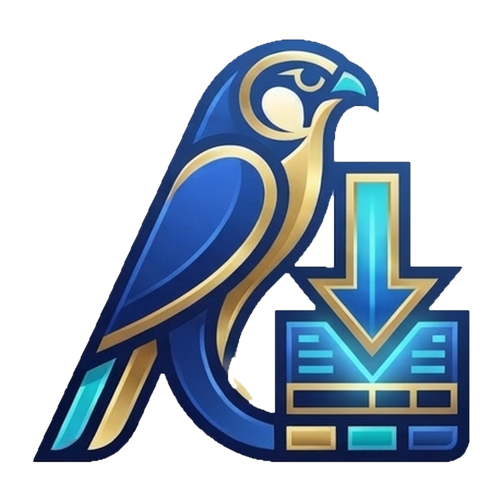

  

<h1 align="center">Kemet Download</h1>

  <b>Professional download manager for Windows and Android</b> 
  <b>مدير تحميلات احترافي لأنظمة ويندوز وأندرويد</b>

  
  
  
  

  <a href="#english">English</a> • <a href="#arabic">العربية</a>

---

## About

**Kemet Download** is a fast, focused download manager. The desktop edition runs on **Windows** (built with Tauri and Rust) and the mobile edition runs on **Android** (built with Kotlin and Jetpack Compose). Paste one link or many, choose how you want the file, and let the queue do the work.

> **Proprietary & Closed Source.** Kemet Download is commercial-grade proprietary software. It is not open source. All rights are reserved by the owner. See [License and Legal Notice](#license-and-legal-notice).

### Features

| Capability | Windows | Android |
|---|:---:|:---:|
| Direct file downloads (archives, installers, games, documents, images) | Yes | Yes |
| Pause and resume interrupted downloads | Yes | Yes |
| Multiple links at once (one link per line) | Yes | Yes |
| Import a `.txt` file full of links | Yes | Share links from other apps |
| Parallel downloads (1, 2, 5, or 10 at a time) | Yes | Yes |
| Automatic retry when the connection drops | Yes | Yes |
| Video from supported media websites, up to 1080p or 720p | Yes | No |
| Playlist and multi-video links | Yes | No |
| Audio-only extraction (original quality or MP3) | Yes | No |
| MP4 or MKV output, with H.264 or H.265 (HEVC) preference | Yes | No |
| Background downloads with progress notifications | No | Yes |
| Arabic-first interface, right-to-left layout | Yes | Yes |

### What you can download

- **Direct links:** games, software installers, ZIP and RAR archives, documents, images, and any other file that has a direct download link, including files from digital stores when the store gives you a direct link.
- **Media (Windows):** videos and audio from the media websites supported by the built-in engine (yt-dlp), with quality, container, and codec controls.

### Privacy

Kemet Download has no advertisements, no accounts, and no analytics or tracking. Your links and downloads stay on your device. The only network traffic the app creates is the traffic needed to download what you ask for, plus the optional engine update you start yourself.

### Installation

Download the latest build from the **[Releases page](https://github.com/Youseff-Abdelnaby/kemet-download/releases/latest)**:

- **Windows:** download the `.exe` installer and run it. Because the installer is not signed with a commercial code-signing certificate, Windows SmartScreen may show a warning. Select **More info**, then **Run anyway**.
- **Android:** download `KemetDownload-universal.apk` and open it. Android asks you to allow installation from this source the first time.

### Media engine note (Windows)

Video and audio from media websites use the yt-dlp engine. Use the in-app **update engine** button to download or refresh it. FFmpeg must be available to merge separate video and audio streams or to convert audio to MP3.

---

## نبذة عن التطبيق

**كيميت داونلود (Kemet Download)** هو مدير تحميلات سريع ومركّز. تعمل نسخة سطح المكتب على **ويندوز** (مبنية بتقنية Tauri ولغة Rust)، وتعمل نسخة الجوال على **أندرويد** (مبنية بلغة Kotlin وJetpack Compose). الصق رابطاً واحداً أو عدة روابط، واختر طريقة التحميل المناسبة، ودع قائمة الانتظار تنجز العمل.

> **برنامج مغلق المصدر ومحمي ملكياً (Proprietary & Closed Source).** كيميت داونلود برنامج تجاري محمي، وهو ليس مفتوح المصدر. جميع الحقوق محفوظة للمالك. راجع قسم [الرخصة والإشعار القانوني](#الرخصة-والإشعار-القانوني).

### المميزات

| الإمكانية | ويندوز | أندرويد |
|---|:---:|:---:|
| تحميل الملفات المباشرة (أرشيفات، برامج، ألعاب، مستندات، صور) | نعم | نعم |
| إيقاف مؤقت واستئناف التحميلات المقطوعة | نعم | نعم |
| روابط متعددة دفعة واحدة (رابط في كل سطر) | نعم | نعم |
| استيراد ملف `.txt` مليء بالروابط | نعم | مشاركة الروابط من التطبيقات الأخرى |
| تحميلات متزامنة (1 أو 2 أو 5 أو 10) | نعم | نعم |
| إعادة المحاولة تلقائياً عند انقطاع الاتصال | نعم | نعم |
| فيديو من مواقع الوسائط المدعومة، حتى جودة 1080 أو 720 | نعم | لا |
| قوائم التشغيل والروابط متعددة الفيديوهات | نعم | لا |
| استخراج الصوت فقط (بالجودة الأصلية أو MP3) | نعم | لا |
| إخراج MP4 أو MKV مع تفضيل ترميز H.264 أو H.265 (HEVC) | نعم | لا |
| تحميل في الخلفية مع إشعارات التقدم | لا | نعم |
| واجهة عربية أولاً بتخطيط من اليمين لليسار | نعم | نعم |

### ماذا يمكنك أن تحمّل

- **الروابط المباشرة:** الألعاب، وبرامج التثبيت، وأرشيفات ZIP وRAR، والمستندات، والصور، وأي ملف له رابط تحميل مباشر، بما في ذلك ملفات المتاجر الرقمية عندما يوفر لك المتجر رابطاً مباشراً.
- **الوسائط (ويندوز):** الفيديو والصوت من مواقع الوسائط التي يدعمها المحرك المدمج (yt-dlp)، مع التحكم في الجودة والصيغة والترميز.

### الخصوصية

لا يحتوي كيميت داونلود على إعلانات ولا حسابات ولا أدوات تحليل أو تتبع. تبقى روابطك وتحميلاتك على جهازك. حركة الشبكة الوحيدة التي ينشئها التطبيق هي ما يلزم لتحميل ما تطلبه، إضافة إلى تحديث المحرك الاختياري الذي تبدأه بنفسك.

### التثبيت

حمّل أحدث نسخة من **[صفحة الإصدارات (Releases)](https://github.com/Youseff-Abdelnaby/kemet-download/releases/latest)**:

- **ويندوز:** حمّل ملف التثبيت بصيغة `.exe` وشغّله. لأن ملف التثبيت غير موقّع بشهادة توقيع تجارية، قد تعرض حماية SmartScreen تحذيراً. اختر **More info** ثم **Run anyway**.
- **أندرويد:** حمّل الملف `KemetDownload-universal.apk` وافتحه. سيطلب منك أندرويد السماح بالتثبيت من هذا المصدر في المرة الأولى.

### ملاحظة عن محرك الوسائط (ويندوز)

يعتمد تحميل الفيديو والصوت من مواقع الوسائط على محرك yt-dlp. استخدم زر **تحديث محرك التحميل** داخل التطبيق لتنزيله أو تحديثه. ويلزم وجود FFmpeg لدمج مساري الصوت والصورة المنفصلين أو لتحويل الصوت إلى MP3.

---

## License and Legal Notice

## الرخصة والإشعار القانوني

**English.** Kemet Download is **Proprietary & Closed Source** software. Copyright (c) 2026 Youseff Abdelnaby. All rights reserved. You may install and use the official compiled releases under the terms in the [LICENSE](LICENSE) file. You may not copy, fork, modify, redistribute, sell, or reverse engineer the software or its source code without prior written permission. Seeing the code on a hosting platform does not grant any right to use it. Third-party components such as yt-dlp and FFmpeg remain under their own licenses. You are responsible for downloading only content you have the legal right to download and for following the terms of the websites you use.

**العربية.** كيميت داونلود برنامج **مغلق المصدر ومحمي ملكياً (Proprietary & Closed Source)**. حقوق النشر (c) 2026 Youseff Abdelnaby. جميع الحقوق محفوظة. يحق لك تثبيت واستخدام الإصدارات الرسمية الجاهزة وفق الشروط الواردة في ملف [LICENSE](LICENSE). لا يجوز نسخ البرنامج أو الكود المصدري أو تفريعه أو تعديله أو إعادة توزيعه أو بيعه أو إجراء هندسة عكسية عليه دون إذن كتابي مسبق. رؤية الكود على منصة استضافة لا تمنحك أي حق في استخدامه. تبقى المكونات الخارجية مثل yt-dlp وFFmpeg تحت رخصها الخاصة. أنت المسؤول عن تحميل المحتوى الذي تملك حقاً قانونياً في تحميله وعن الالتزام بشروط المواقع التي تستخدمها.

## Support / الدعم

Open an [Issue](https://github.com/Youseff-Abdelnaby/kemet-download/issues) to report a bug or request a feature. Issues are for feedback only. Code contributions and pull requests are not accepted.

افتح [Issue](https://github.com/Youseff-Abdelnaby/kemet-download/issues) للإبلاغ عن مشكلة أو لاقتراح ميزة. الـ Issues مخصصة للملاحظات فقط، ولا تُقبل مساهمات الكود أو طلبات الدمج.

---

  <b>© 2026 Kemet Download — Proprietary & Closed Source. All rights reserved.</b>

